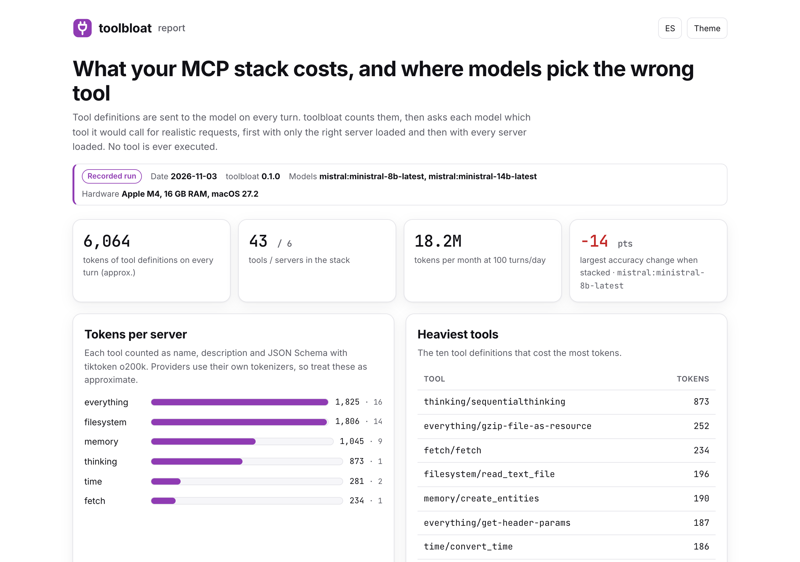
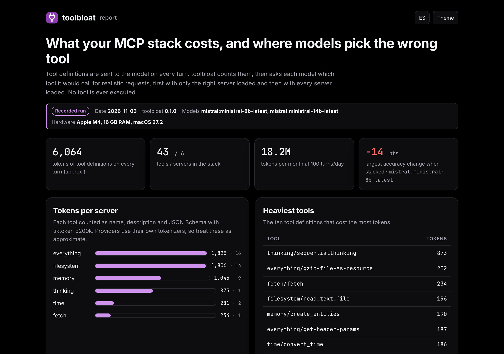
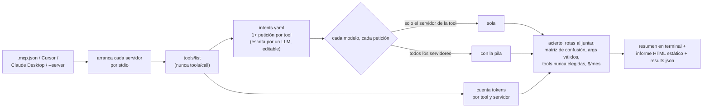

<p align="center">
  <picture>
    <source media="(prefers-color-scheme: dark)" srcset="docs/assets/banner-dark.svg">
    
  </picture>
</p>

<p align="center">
  <a href="https://github.com/diegoperezg7/toolbloat/actions/workflows/ci.yml"></a>
  <a href="LICENSE"></a>
  <a href="https://github.com/diegoperezg7/toolbloat/releases"></a>
  <a href="https://github.com/diegoperezg7/toolbloat/stargazers"></a>
</p>

<p align="center"><b>Mira cuántos tokens te cuestan tus servidores MCP en cada turno, y si al juntarlos tu modelo empieza a elegir la tool equivocada.</b></p>

<p align="center"><a href="README.md">Read in English</a> · <a href="https://diegoperezg7.github.io/toolbloat/">Informe de ejemplo</a></p>

<p align="center"></p>

## Por qué

Cada servidor MCP que conectas envía las definiciones de sus tools al modelo en cada turno. Ya hay
herramientas para ver ese coste: Claude Code muestra los tokens de las tools MCP en
[`/context`](https://code.claude.com/docs/en/slash-commands),
[mcp-bloat](https://github.com/pranayasharma/mcp-bloat) los audita por servidor, y
[mcp-compressor](https://github.com/atlassian-labs/mcp-compressor) o
[squeez](https://github.com/claudioemmanuel/squeez) los reducen. También hay herramientas que revisan
las descripciones de un servidor: [toolfit](https://github.com/sreshtalluri/toolfit) y
[toolscore](https://github.com/Aryan-MP/toolscore) encuentran qué tools de *un* servidor confunden a un
modelo, y [LiveMCPBench](https://github.com/icip-cas/LiveMCPBench) es un benchmark fijo sobre un
conjunto grande de tools.

Ninguna responde a la pregunta que tienes cuando usas cinco servidores a la vez: **¿al juntarlos mi
modelo elige peor, cuánto depende eso del modelo y cuánto pago por ello en cada turno?** toolbloat
mide exactamente eso, sobre tu propia pila:

- tokens por tool, por servidor y en total, más los tokens de prompt que factura cada proveedor;
- acierto al elegir tool por modelo con **solo el servidor de la tool** cargado frente a **toda la pila**;
- qué peticiones se rompen al juntar servidores, y una **matriz de confusión entre servidores**;
- si los argumentos que propone el modelo validan contra el JSON Schema de la tool;
- tools que ningún modelo eligió, los tokens que ahorrarías quitándolas y una proyección mensual.

Las tools **nunca se ejecutan**: toolbloat solo lee la llamada que propone el modelo.

## Inicio rápido

Mira una ejecución real grabada, sin claves ni configuración (necesita [uv](https://docs.astral.sh/uv/)):

```bash
uvx --from git+https://github.com/diegoperezg7/toolbloat@v0.1.1 toolbloat demo --open
```

o desde un clon:

```bash
git clone https://github.com/diegoperezg7/toolbloat && cd toolbloat && uv run toolbloat demo --open
```

`uvx toolbloat` llegará pronto a PyPI.

Después mide tu propia pila:

```bash
# solo tokens, sin llamar a modelos: lee ./.mcp.json y las configs de Cursor y Claude Desktop
toolbloat tokens

# ejecución completa con un modelo local (nada sale de tu máquina)
toolbloat run -m ollama:qwen3:4b-16k

# o compara varios modelos (claves en variables de entorno), con tope de 1 USD
toolbloat run -m ollama:qwen3:4b-16k -m mistral:ministral-8b-latest -m mistral:mistral-small-latest --max-cost 1
```

## Ejemplo de salida

<!-- demo:start -->
```text
$ toolbloat demo
Recorded run from 2026-11-03 · toolbloat 0.1.0 · Apple M4, 16 GB RAM, macOS 27.2
This replays a real `toolbloat run`; nothing is executed now. Measure your own stack with `toolbloat
run`.
Tokens per server (o200k, approx.)     
┏━━━━━━━━━━━━┳━━━━━━━┳━━━━━━━━┳━━━━━━━┓
┃ server     ┃ tools ┃ tokens ┃ share ┃
┡━━━━━━━━━━━━╇━━━━━━━╇━━━━━━━━╇━━━━━━━┩
│ everything │    16 │  1,825 │   30% │
│ filesystem │    14 │  1,806 │   30% │
│ memory     │     9 │  1,045 │   17% │
│ thinking   │     1 │    873 │   14% │
│ time       │     2 │    281 │    5% │
│ fetch      │     1 │    234 │    4% │
├────────────┼───────┼────────┼───────┤
│ total      │    43 │  6,064 │  100% │
└────────────┴───────┴────────┴───────┘
Every turn re-sends ~6,064 tokens of tool definitions: ~18.2M tokens/month at 100 turns/day (before 
prompt caching).
Tool selection accuracy (alone vs. whole stack)                                          
┏━━━━━━━━━━━━━━━━━━━━━━━━━━━━━━┳━━━━━━━┳━━━━━━━━━┳━━━━━━━━━┳━━━━━━━━┳━━━━━━━━━┳━━━━━━━━━┓
┃ model                        ┃ alone ┃ stacked ┃  change ┃ broken ┃ args ok ┃ $/month ┃
┡━━━━━━━━━━━━━━━━━━━━━━━━━━━━━━╇━━━━━━━╇━━━━━━━━━╇━━━━━━━━━╇━━━━━━━━╇━━━━━━━━━╇━━━━━━━━━┩
│ mistral:ministral-8b-latest  │   86% │     72% │ -14 pts │      6 │    100% │   $2.73 │
│ mistral:ministral-14b-latest │   91% │     86% │  -5 pts │      2 │    100% │   $3.64 │
└──────────────────────────────┴───────┴─────────┴─────────┴────────┴─────────┴─────────┘
broken = right alone, wrong with the whole stack · args ok = correct calls whose arguments match the
JSON Schema
Most common wrong picks with the whole stack                                          
┏━━━━━━━━━━━━━━━━━━━━━━━━━━━━━━━━━━━━━━┳━━━━━━━━━━━━━━━━━━━━━━━━━━━━━━━━━━━━━┳━━━━━━━┓
┃ expected                             ┃ model chose                         ┃ times ┃
┡━━━━━━━━━━━━━━━━━━━━━━━━━━━━━━━━━━━━━━╇━━━━━━━━━━━━━━━━━━━━━━━━━━━━━━━━━━━━━╇━━━━━━━┩
│ memory/create_relations              │ memory/create_entities              │     2 │
│ filesystem/write_file                │ filesystem/create_directory         │     2 │
│ memory/delete_observations           │ memory/search_nodes                 │     2 │
│ filesystem/edit_file                 │ filesystem/read_text_file           │     2 │
│ filesystem/list_directory_with_sizes │ filesystem/list_allowed_directories │     2 │
│ filesystem/read_file                 │ filesystem/list_allowed_directories │     1 │
│ filesystem/read_text_file            │ filesystem/list_allowed_directories │     1 │
│ filesystem/read_media_file           │ filesystem/search_files             │     1 │
└──────────────────────────────────────┴─────────────────────────────────────┴───────┘
5 tool(s) were never chosen with the whole stack: filesystem/edit_file, memory/create_relations, 
filesystem/list_directory_with_sizes, memory/delete_observations, filesystem/write_file. Removing 
them saves ~690 tokens per turn (~2.1M/month).
API cost of the calls in this report: $0.1447
```
<!-- demo:end -->

El informe completo de esta ejecución está en **<https://diegoperezg7.github.io/toolbloat/>**.

<p align="center">
  
  
</p>

## Cómo funciona



1. **Descubrir.** Cada servidor se arranca con el SDK oficial de MCP para Python (`mcp==2.3.0`) y se
   le pide `tools/list`. De tus configs solo se muestran `command` y `args`; `env` se pasa al servidor
   pero nunca se imprime ni se guarda.
2. **Contar.** Cada tool se serializa como función al estilo OpenAI (nombre, descripción, JSON Schema)
   y se cuenta con tiktoken `o200k_base`. Cada proveedor envuelve las tools con su propia plantilla y
   tokenizer, así que es **aproximado**; el informe también muestra los tokens de prompt facturados.
3. **Escribir intenciones.** Un modelo escribe peticiones realistas para cada tool
   (`.toolbloat/intents.yaml`). Se cachean; puedes editarlas, añadir `also_ok` para tools igual de
   válidas o `skip: true`.
4. **Preguntar.** Para cada petición, cada modelo recibe el mismo prompt de sistema («llama exactamente
   a una tool») a temperatura 0, una vez con las tools de su servidor y otra con todas. Las respuestas se
   cachean en `toolbloat-report/calls.jsonl`, así que una ejecución interrumpida continúa sin coste.
5. **Informe.** `results.json`, un resumen Rich en la terminal y un informe HTML de un solo fichero.

## Configuración

| Opción | Por defecto | Qué hace |
| --- | --- | --- |
| `-m, --model proveedor:modelo` | `ollama:qwen3:4b` | Repetible. Proveedores: `ollama`, `mistral`, `openrouter`, `openai`. |
| `-c, --config RUTA` | auto | `.mcp.json`, `.cursor/mcp.json`, `~/.cursor/mcp.json`, config de Claude Desktop. Repetible. |
| `-s, --server "nombre=cmd args"` | – | Añade un servidor a mano. Repetible. |
| `--intents RUTA` | `.toolbloat/intents.yaml` | Peticiones cacheadas y editables. |
| `--intent-model` | primer `--model` | Modelo que escribe las intenciones que falten. |
| `--intents-per-tool N` | `1` | Más peticiones por tool = cifras más estables, más llamadas. |
| `--max-cost USD` | `1.0` | Se comprueba antes de cada llamada; para con resultados parciales. Los modelos locales cuestan 0. |
| `--price proveedor:modelo=IN,OUT` | – | USD por millón de tokens para un modelo sin precio incluido. |
| `--turns-per-day N` | `100` | Para la proyección mensual. |
| `--out DIR` | `toolbloat-report` | `results.json`, `report.html`, `calls.jsonl`. |

Las claves solo se leen de variables de entorno: `MISTRAL_API_KEY`, `OPENROUTER_API_KEY`,
`OPENAI_API_KEY`. `OLLAMA_HOST` apunta a otro Ollama. Mira [.env.example](.env.example).

**Ventana de contexto de Ollama.** Ollama carga los modelos con una ventana pequeña por defecto
(4.096 tokens para `qwen3:4b` aquí). Una pila de varios servidores ocupa más y se corta sin avisar;
toolbloat avisa cuando un modelo factura menos tokens de prompt que las definiciones. Crea una
variante con más ventana una vez (`num_ctx` 16384) y úsala:

```bash
printf 'FROM qwen3:4b\nPARAMETER num_ctx 16384\n' > Modelfile && ollama create qwen3:4b-16k -f Modelfile
```

Probado con una ejecución parcial de `ollama:qwen3:4b-16k` (32 llamadas reales sobre la pila de referencia; el prompt más
largo fue de 5.193 tokens, muy por debajo de la ventana de 16.384). No está en la demo grabada: un modelo local de 4B
con thinking tardaba varios minutos por llamada en un portátil de 16 GB compartido.

**Privacidad.** Con un proveedor en la nube, las definiciones de tus tools y las peticiones de prueba
se le envían. Antes de enviar nada, toolbloat muestra qué servidores se van a mandar y a qué proveedor,
y pide confirmación; sin terminal (CI) se niega salvo que pases `--yes`. Con Ollama nada sale de tu máquina. No hay telemetría. Ejecutar toolbloat arranca los
servidores MCP de tu config, que es código de terceros que ya ejecutas con tu agente: mira
[SECURITY.md](SECURITY.md).

## Los datos de la demo

`toolbloat demo` reproduce una ejecución real de `toolbloat run` del 2026-11-03 sobre seis
[servidores de referencia de MCP](https://github.com/modelcontextprotocol/servers) que arrancan sin
credenciales: `server-filesystem`, `server-memory`, `server-everything`, `server-sequential-thinking`
(npm) y `mcp-server-time`, `mcp-server-fetch` (PyPI). Se publican con licencia MIT, y el proyecto está
pasando las contribuciones nuevas a Apache-2.0 ([LICENSE](https://github.com/modelcontextprotocol/servers/blob/main/LICENSE)).
toolbloat no incluye su código, solo las definiciones de tools que devolvieron.

Modelos de la grabación: `mistral:ministral-8b-latest` y `mistral:ministral-14b-latest`, cada uno con las 43 peticiones en las dos condiciones (172 llamadas, 0,14 USD en total a precio de lista). Las peticiones las escribió `ministral-8b-latest` y se revisaron a mano. Los avisos de terceros de las definiciones de tools incluidas están en [NOTICE](NOTICE). La config está en
[`examples/reference-stack.mcp.json`](examples/reference-stack.mcp.json) y las intenciones revisadas en
[`examples/reference-stack.intents.yaml`](examples/reference-stack.intents.yaml).

## Hoja de ruta

- Ejecutar las tools en un sandbox para comprobar resultados, no solo la elección.
- Proponer reescrituras de descripciones para las tools que se confunden.
- Transportes HTTP y SSE.
- Comparar una pila con y sin un compresor como mcp-compressor.

## Parte de una serie

Herramientas open source para medir agentes y LLMs con tus propios datos:

- [memarena](https://github.com/diegoperezg7/memarena): Compara capas de memoria con tus propias conversaciones.
- [parsearena](https://github.com/diegoperezg7/parsearena): Compara parsers de PDF lado a lado y su efecto en la recuperación.
- [commitarena](https://github.com/diegoperezg7/commitarena): Reproduce fixes reales de tu historial de git con cualquier modelo.
- [rulelab](https://github.com/diegoperezg7/rulelab): Descubre qué reglas de tu AGENTS.md se ganan sus tokens.
- [doesitfire](https://github.com/diegoperezg7/doesitfire): Comprueba si tu SKILL.md se activa en Claude Code, Codex y OpenCode.

## Licencia

[MIT](LICENSE) © 2026 Diego Pérez
