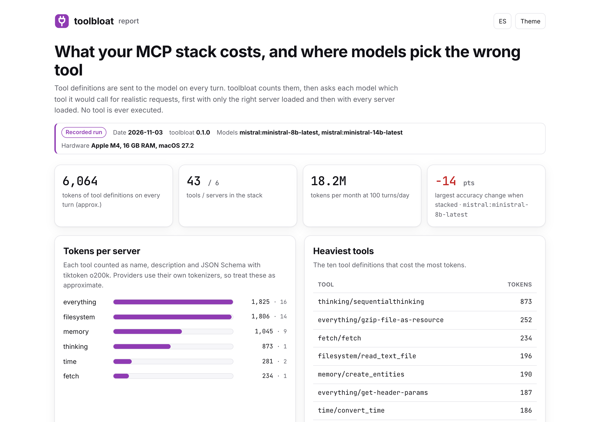
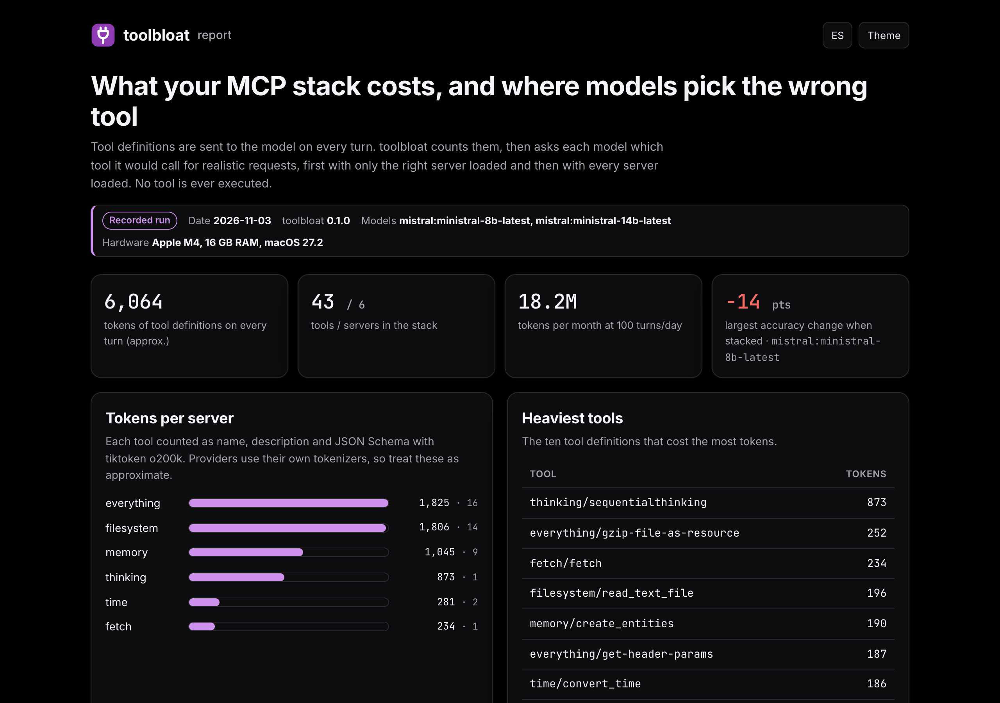
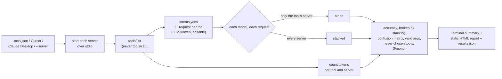

<p align="center">
  <picture>
    <source media="(prefers-color-scheme: dark)" srcset="docs/assets/banner-dark.svg">
    
  </picture>
</p>

<p align="center">
  <a href="https://github.com/diegoperezg7/toolbloat/actions/workflows/ci.yml"></a>
  <a href="LICENSE"></a>
  <a href="https://github.com/diegoperezg7/toolbloat/releases"></a>
  <a href="https://github.com/diegoperezg7/toolbloat/stargazers"></a>
</p>

<p align="center"><b>See what your MCP servers cost in tokens on every turn, and whether stacking them makes your model pick the wrong tool.</b></p>

<p align="center"><a href="README.es.md">Leer en español</a> · <a href="https://diegoperezg7.github.io/toolbloat/">Example report</a></p>

<p align="center"></p>

## Why

Every MCP server you connect sends its tool definitions to the model on every turn. Tools exist to
see that cost: Claude Code shows MCP tool tokens in [`/context`](https://code.claude.com/docs/en/slash-commands),
[mcp-bloat](https://github.com/pranayasharma/mcp-bloat) audits them per server, and
[mcp-compressor](https://github.com/atlassian-labs/mcp-compressor) or
[squeez](https://github.com/claudioemmanuel/squeez) shrink them. Tools also exist to check one
server's tool descriptions: [toolfit](https://github.com/sreshtalluri/toolfit) and
[toolscore](https://github.com/Aryan-MP/toolscore) find which tools of *a* server confuse a model,
and [LiveMCPBench](https://github.com/icip-cas/LiveMCPBench) is a fixed benchmark over a large toolset.

None of them answers the question you have once you run five servers at once: **does stacking
them make my model pick the wrong tool, how much does that depend on the model, and what am I
paying per turn for it?** toolbloat measures exactly that, on your own stack:

- tokens per tool, per server and in total, plus the prompt tokens each provider actually bills;
- selection accuracy per model with **only the tool's own server** loaded vs. **the whole stack**;
- which requests stacking breaks, and a **cross-server confusion matrix**;
- whether the arguments the model proposes validate against the tool's JSON Schema;
- tools no model chose, the tokens you would save by removing them, and a monthly projection.

Tools are **never executed**: toolbloat only reads the tool call the model proposes.

## Quickstart

See a recorded real run, no keys and no setup (needs [uv](https://docs.astral.sh/uv/)):

```bash
uvx --from git+https://github.com/diegoperezg7/toolbloat@v0.1.0 toolbloat demo --open
```

or from a clone:

```bash
git clone https://github.com/diegoperezg7/toolbloat && cd toolbloat && uv run toolbloat demo --open
```

`uvx toolbloat` is coming to PyPI.

Then measure your own stack:

```bash
# tokens only, no model calls: reads ./.mcp.json, Cursor and Claude Desktop configs
toolbloat tokens

# full run with a local model (nothing leaves your machine)
toolbloat run -m ollama:qwen3:4b-16k

# or compare several models (keys from env vars), capped at 1 USD
toolbloat run -m ollama:qwen3:4b-16k -m mistral:ministral-8b-latest -m mistral:mistral-small-latest --max-cost 1
```

## Example output

<!-- demo:start -->
```text
$ toolbloat demo
Recorded run from 2026-11-03 · toolbloat 0.1.0 · Apple M4, 16 GB RAM, macOS 27.2
This replays a real `toolbloat run`; nothing is executed now. Measure your own stack with `toolbloat
run`.
Tokens per server (o200k, approx.)     
┏━━━━━━━━━━━━┳━━━━━━━┳━━━━━━━━┳━━━━━━━┓
┃ server     ┃ tools ┃ tokens ┃ share ┃
┡━━━━━━━━━━━━╇━━━━━━━╇━━━━━━━━╇━━━━━━━┩
│ everything │    16 │  1,825 │   30% │
│ filesystem │    14 │  1,806 │   30% │
│ memory     │     9 │  1,045 │   17% │
│ thinking   │     1 │    873 │   14% │
│ time       │     2 │    281 │    5% │
│ fetch      │     1 │    234 │    4% │
├────────────┼───────┼────────┼───────┤
│ total      │    43 │  6,064 │  100% │
└────────────┴───────┴────────┴───────┘
Every turn re-sends ~6,064 tokens of tool definitions: ~18.2M tokens/month at 100 turns/day (before 
prompt caching).
Tool selection accuracy (alone vs. whole stack)                                          
┏━━━━━━━━━━━━━━━━━━━━━━━━━━━━━━┳━━━━━━━┳━━━━━━━━━┳━━━━━━━━━┳━━━━━━━━┳━━━━━━━━━┳━━━━━━━━━┓
┃ model                        ┃ alone ┃ stacked ┃  change ┃ broken ┃ args ok ┃ $/month ┃
┡━━━━━━━━━━━━━━━━━━━━━━━━━━━━━━╇━━━━━━━╇━━━━━━━━━╇━━━━━━━━━╇━━━━━━━━╇━━━━━━━━━╇━━━━━━━━━┩
│ mistral:ministral-8b-latest  │   86% │     72% │ -14 pts │      6 │    100% │   $2.73 │
│ mistral:ministral-14b-latest │   91% │     86% │  -5 pts │      2 │    100% │   $3.64 │
└──────────────────────────────┴───────┴─────────┴─────────┴────────┴─────────┴─────────┘
broken = right alone, wrong with the whole stack · args ok = correct calls whose arguments match the
JSON Schema
Most common wrong picks with the whole stack                                          
┏━━━━━━━━━━━━━━━━━━━━━━━━━━━━━━━━━━━━━━┳━━━━━━━━━━━━━━━━━━━━━━━━━━━━━━━━━━━━━┳━━━━━━━┓
┃ expected                             ┃ model chose                         ┃ times ┃
┡━━━━━━━━━━━━━━━━━━━━━━━━━━━━━━━━━━━━━━╇━━━━━━━━━━━━━━━━━━━━━━━━━━━━━━━━━━━━━╇━━━━━━━┩
│ memory/create_relations              │ memory/create_entities              │     2 │
│ filesystem/write_file                │ filesystem/create_directory         │     2 │
│ memory/delete_observations           │ memory/search_nodes                 │     2 │
│ filesystem/edit_file                 │ filesystem/read_text_file           │     2 │
│ filesystem/list_directory_with_sizes │ filesystem/list_allowed_directories │     2 │
│ filesystem/read_file                 │ filesystem/list_allowed_directories │     1 │
│ filesystem/read_text_file            │ filesystem/list_allowed_directories │     1 │
│ filesystem/read_media_file           │ filesystem/search_files             │     1 │
└──────────────────────────────────────┴─────────────────────────────────────┴───────┘
5 tool(s) were never chosen with the whole stack: filesystem/edit_file, memory/create_relations, 
filesystem/list_directory_with_sizes, memory/delete_observations, filesystem/write_file. Removing 
them saves ~690 tokens per turn (~2.1M/month).
API cost of the calls in this report: $0.1447
```
<!-- demo:end -->

The full report for this run is at **<https://diegoperezg7.github.io/toolbloat/>**.

<p align="center">
  
  
</p>

## How it works



1. **Discover.** Each server is started with the official MCP Python SDK (`mcp==2.3.0`) and asked
   for `tools/list`. Only `command` and `args` are read from your configs for display; `env` is
   passed to the server but never printed or saved.
2. **Count.** Each tool is serialised as an OpenAI-style function (name, description, JSON Schema)
   and counted with tiktoken `o200k_base`. Providers wrap tools in their own templates and
   tokenizers, so this is **approximate**; the report also shows the prompt tokens each provider billed.
3. **Write intents.** A model writes realistic requests for each tool (`.toolbloat/intents.yaml`).
   They are cached; edit them, add `also_ok` for tools that are equally right, or `skip: true`.
4. **Ask.** For every request, each model gets the same system prompt ("call exactly one tool") at
   temperature 0, once with only the right server's tools and once with every tool. Answers are
   cached in `toolbloat-report/calls.jsonl`, so interrupted runs resume for free.
5. **Report.** `results.json`, a Rich summary in the terminal and a single-file HTML report.

## Configuration

| Option | Default | What it does |
| --- | --- | --- |
| `-m, --model provider:model` | `ollama:qwen3:4b` | Repeatable. Providers: `ollama`, `mistral`, `openrouter`, `openai`. |
| `-c, --config PATH` | auto | `.mcp.json`, `.cursor/mcp.json`, `~/.cursor/mcp.json`, Claude Desktop config. Repeatable. |
| `-s, --server "name=cmd args"` | – | Add a server by hand. Repeatable. |
| `--intents PATH` | `.toolbloat/intents.yaml` | Cached, editable requests. |
| `--intent-model` | first `--model` | Model that writes missing intents. |
| `--intents-per-tool N` | `1` | More requests per tool = steadier numbers, more calls. |
| `--max-cost USD` | `1.0` | Checked before every call; the run stops with partial results. Local models cost 0. |
| `--price provider:model=IN,OUT` | – | USD per million tokens for a model without a built-in price. |
| `--turns-per-day N` | `100` | For the monthly projection. |
| `--out DIR` | `toolbloat-report` | `results.json`, `report.html`, `calls.jsonl`. |

Keys come only from environment variables: `MISTRAL_API_KEY`, `OPENROUTER_API_KEY`,
`OPENAI_API_KEY`. `OLLAMA_HOST` points to another Ollama. See [.env.example](.env.example).

**Ollama context window.** Ollama loads models with a small context window by default (4,096 tokens
for `qwen3:4b` here). A stack of a few servers is larger than that and gets cut silently;
toolbloat warns when a model bills fewer prompt tokens than the definitions. Create a variant with a
bigger window once (`num_ctx` 16384) and use it:

```bash
printf 'FROM qwen3:4b\nPARAMETER num_ctx 16384\n' > Modelfile && ollama create qwen3:4b-16k -f Modelfile
```

Tested with `ollama:qwen3:4b-16k` in a short real run (32 calls on the reference stack; the largest prompt was 5,193
tokens, well under the 16,384 window). It is not in the recorded demo: a local 4B model with thinking took several
minutes per call on a shared 16 GB laptop.

**Privacy.** With a cloud provider, your tool definitions and the test requests are sent to it.
With Ollama nothing leaves your machine. There is no telemetry. Running toolbloat starts the MCP
servers in your config, which is third-party code you already run with your agent: see
[SECURITY.md](SECURITY.md).

## The demo data

`toolbloat demo` replays a real `toolbloat run` from 2026-11-03 on six servers from the
[MCP reference servers](https://github.com/modelcontextprotocol/servers), which start without
credentials: `server-filesystem`, `server-memory`, `server-everything`, `server-sequential-thinking`
(npm) and `mcp-server-time`, `mcp-server-fetch` (PyPI). They are published under MIT, with the
project moving new contributions to Apache-2.0 ([LICENSE](https://github.com/modelcontextprotocol/servers/blob/main/LICENSE)).
toolbloat does not bundle their code, only the tool definitions they returned.

Models in the recording: `mistral:ministral-8b-latest` and `mistral:ministral-14b-latest`, each on all 43 requests in both conditions (172 calls, 0.14 USD in total at list price). Requests were written by `ministral-8b-latest` and reviewed by hand. Third-party notices for the bundled tool definitions are in [NOTICE](NOTICE). The config is in
[`examples/reference-stack.mcp.json`](examples/reference-stack.mcp.json) and the reviewed intents in
[`examples/reference-stack.intents.yaml`](examples/reference-stack.intents.yaml).

## Roadmap

- Execute tools in a sandbox to check results, not just the choice.
- Suggest description rewrites for the tools that get confused.
- HTTP and SSE transports.
- Compare a stack with and without a compressor such as mcp-compressor.

## License

[MIT](LICENSE) © 2026 Diego Pérez
